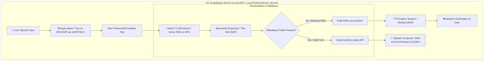

# 🚀 Qualcomm Megathon X: AI Incident Report Assistant — Winning Battle Plan

---

## 1. Deconstructing the Problem Statement

### The Official Flow (from Slide 3 Diagram):
$$\text{Microphone} \longrightarrow \text{Speech-to-Text} \longrightarrow \text{LLM Information Extraction} \longrightarrow \text{Mandatory Fields Present?} \longrightarrow \text{Function/Tool Calling} \longrightarrow \text{Populate Form \& Review} \longrightarrow \begin{cases} \text{Display on Screen} \\ \text{Text-to-Speech (TTS)} \end{cases}$$

### Key Requirements & Constraints:
* **Constraint 1 (Hard):** All AI models **must execute on-device using Snapdragon acceleration**. Strictly **NO cloud APIs**.
* **Constraint 2:** Natural conversational speech comprehension (not rigid voice commands like "set field incident_type to water leak").
* **Constraint 3:** High transcription & extraction accuracy.
* **Constraint 4:** **Function / Tool calling** triggered when mandatory fields are satisfied (e.g. `submit_incident_report(...)`, `request_missing_info(...)`).
* **Constraint 5:** Interactive loop: Prompt user back via voice/TTS for missing mandatory fields if details are missing!

---

## 2. Why This is 10x Better For You Than Last Year's Generative Art

| Dimension | 2025 (SnapGen / Stable Diffusion) | 2026 (AI Incident Report Assistant) |
| :--- | :--- | :--- |
| **Domain** | Computer Vision / Heavy Diffusion UNet | **Audio / Speech + NLP / Function Calling** |
| **Your Prior Skill Overlap** | Low (Image synthesis) | **EXTREMELY HIGH** (Sentinel audio pipeline, ASR, FastAPI, low-latency streaming) |
| **NPU Model Class** | Heavy 1GB+ Diffusion UNet (extremely prone to out-of-memory on DSP) | **Whisper (ASR) + Lightweight Quantized LLM / SLM (Llama 3.2 1B / 3B or Electra/BERT)** |
| **Pre-existing Reference in QIDK** | Forking external Local-Dream | **Official sample in QIDK repo:** `NLPSolution3-AutomaticSpeechRecognition-Whisper` |
| **Demo Format** | Single image display | **Real-time spoken dialogue, dynamic form fill, live audio feedback** |

---

## 3. High-Scoring Architectural Blueprint

To guarantee you do not fall into the runner-up trap (which used a cloud/networked backend and missed 1st place), here is the winning on-device architecture:

### The "Niche Differentiators" That Win First Place:
1. **Interactive Multi-Turn Dialogue (The Active Inquiry Loop):**
   * *Average team:* User speaks once. If a field is missing, it leaves it blank.
   * *Winning team:* If the user says *"There was a chemical spill in lab 4,"* the app immediately uses TTS to say: *"Got that. What was the severity, and was anyone injured?"* Once answered, it merges the turns into a single unified incident schema!
2. **Deterministic Schema Function Calling:**
   * Pass a strict Pydantic/JSON tool definition to the local LLM.
   * Output strictly valid JSON or trigger native functions.
3. **Dual Modality (Audio + Camera Snapshot as Bonus):**
   * The user reports: *"Equipment damage on Conveyor belt 3"*, points phone camera at it, and the app attaches the snapshot and verifies damage category!

---

## 4. Immediate 24-Hour Execution Timeline & Division of Labor

With 4 teammates, structure the team into strict parallel tracks:

### Team Roles:
* **Member 1 (You - Pipeline & Inference Lead):**
  * Set up Qualcomm AI Hub / QIDK Whisper model & LLM execution on the Snapdragon platform.
  * Define the JSON schemas and function calling prompts.
* **Member 2 (Android / Frontend Lead):**
  * Build the Clean Incident Form UI (Jetpack Compose or React Native/Flutter).
  * Design: Live audio visualizer waveform, real-time live transcript display, interactive form cards that automatically light up green as fields get recognized.
* **Member 3 (Dialogue State Manager & TTS):**
  * Build the multi-turn state machine: Checks missing fields (`Incident Type`, `Severity`, `Location`, `Time`, `Immediate Action`).
  * Integrate on-device Text-to-Speech so the phone talks back to prompt for missing details.
* **Member 4 (Demo Czar, Pitch & Edge Cases):**
  * Script 3 realistic corporate/industrial incident demos (e.g. Electrical Hazard, Cyber Incident, Workplace Injury).
  * Build the pre-recorded fallback video and one-pager presentation deck.
  * Prepare judge Q&A answers (e.g. latency numbers, model sizes, NPU vs CPU power stats).

---

## 5. Technical Milestones Checklist for Tonight

- [ ] **Milestone 1 (Hour 0–3): Audio Pipeline & Whisper on Device**
  * Pull `Solutions/NLPSolution3-AutomaticSpeechRecognition-Whisper` from `github.com/quic/qidk`.
  * Validate audio recording $\to$ transcription running locally on device without network.
- [ ] **Milestone 2 (Hour 3–7): Model Execution & Tool Calling**
  * Run quantized Llama 3.2 1B / 3B or Electra via QAIRT / Qualcomm AI Hub / Genie SDK.
  * Test prompt for zero-shot incident slot filling with JSON output.
- [ ] **Milestone 3 (Hour 7–12): Integration of the Extraction Logic**
  * Connect Transcribed Text $\to$ LLM Extraction $\to$ Validation check $\to$ Form field mapping.
- [ ] **Milestone 4 (Hour 12–16): Multi-turn Voice Feedback (TTS)**
  * Add the audio prompt loop for missing fields.
- [ ] **Milestone 5 (Hour 16–20): UI Polish & Form Submission Mock**
  * Beautiful incident dashboard with export (PDF / Email / Ticket webhook).
- [ ] **Milestone 6 (Hour 20–24): Lock the Demo, Pitch Rehearsal**
  * Disconnect Wi-Fi completely on stage to prove 100% on-device operation.
